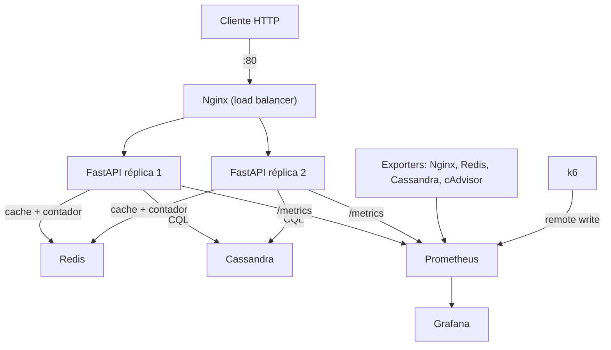

# 🔗 URL Shortener System

> Encurtador de URLs dimensionado para alto volume de leitura, com réplicas da API atrás de load balancer, cache, observabilidade e testes de carga. Sobe inteiro com um `docker compose up`.


[](https://hub.docker.com/r/moisesvn/url-shortener-api)

---

## 1. Visão geral

| Requisito de projeto | Como foi atendido |
|---|---|
| Meta de dimensionamento: **10 milhões de URLs novas por dia** (cerca de 116 escritas/s e 1.160 leituras/s em média) | API stateless replicada, leitura servida pelo cache Redis e Cassandra para a escrita |
| Proporção **10:1** de leitura para escrita | Cache-aside no Redis com TTL de 24h |
| Retenção de **10 anos** | TTL de 315.360.000 s na tabela do Cassandra |
| Códigos curtos e **sem colisão** entre réplicas | `INCR` atômico no Redis + HashIds em base62, com no mínimo 4 caracteres |

### O que eu acrescentei
O projeto partiu da arquitetura apresentada no vídeo [Arquitetando um Encurtador de URL](https://www.youtube.com/watch?v=m_anIoKW7Jg), do canal [Renato Augusto](https://www.youtube.com/@RenatoAugustoTech). Em cima dela, implementei:
- **Testes unitários** (pytest + pytest-asyncio)
- **5 cenários de teste de carga** com k6 e SLOs definidos
- **Stack de observabilidade completa**: Prometheus, Grafana e 4 exporters
- Health check agregado de todos os containers
- Dockerfile multi-stage, rodando sem root, com a imagem da API publicada no [Docker Hub](https://hub.docker.com/r/moisesvn/url-shortener-api) (`moisesvn/url-shortener-api:1.0.0`)

---

## 2. Arquitetura



**Fluxo de leitura (`GET /{code}`):** Redis (hit) → 302. Em caso de miss: Cassandra → grava no Redis → 302.
**Fluxo de escrita (`POST /api/v1/shorten`):** `INCR` no Redis → HashIds → grava no Cassandra com TTL → 201.

### Limitações conhecidas (e como resolveria em produção)
| Hoje | Em produção |
|---|---|
| Redis em nó único (o contador é ponto único de falha) | Redis Sentinel/Cluster, ou contador em faixas pré-alocadas por réplica |
| Cassandra em nó único | Cluster com 3 nós ou mais, `RF=3`, consistência `LOCAL_QUORUM` |
| Tudo em um único host | Orquestração (Kubernetes/ECS) em mais de uma zona |
| `/api/v1/containers/health` aberto (expõe hosts e latências internas) | Restringir a uma rede interna ou exigir autenticação |

---

## 3. Como executar

Pré-requisitos: Docker e Docker Compose. As portas 80, 9090 e 3005 precisam estar livres.

```bash
git clone https://github.com/MoisesVNdev/url-shortener-system.git
cd url-shortener-system
cp .env.example .env    # defina HASHIDS_SALT (obrigatório, igual em todas as réplicas)
docker compose up -d
```

> A imagem da API também está pronta no Docker Hub: [`moisesvn/url-shortener-api`](https://hub.docker.com/r/moisesvn/url-shortener-api) (tags `1.0.0` e `latest`, linux/amd64). Para usá-la em vez do build local, troque `build: .` por `image: moisesvn/url-shortener-api:1.0.0` no serviço `web` do `docker-compose.yml`.

> O Cassandra pode levar de 60 a 90 s para ficar *healthy*. As réplicas da API só sobem depois disso.

```bash
curl http://localhost/health
curl -X POST http://localhost/api/v1/shorten -H "Content-Type: application/json" \
  -d '{"url": "https://exemplo.com/artigo-longo"}'
# {"short_url": "http://localhost/D4p5"}
curl -i http://localhost/D4p5
# HTTP/1.1 302 Found
# Location: https://exemplo.com/artigo-longo
```

| Serviço | URL |
|---|---|
| API / Swagger | http://localhost/docs |
| Prometheus | http://localhost:9090 |
| Grafana | http://localhost:3005 (troque a senha padrão no primeiro acesso) |

---

## 4. Endpoints

| Método | Endpoint | Descrição | Resposta |
|---|---|---|---|
| `POST` | `/api/v1/shorten` | Cria o código curto | `201` |
| `GET` | `/{shortcode}` | Redireciona (o código segue o regex `^[0-9A-Za-z]{4,}$`) | `302` / `404` |
| `GET` | `/health` | Saúde da API, do Redis e do Cassandra | `200` |
| `GET` | `/api/v1/containers/health` | Saúde agregada de todos os containers | `200` |
| `GET` | `/api/v1/debug/urls` | Diagnóstico: registros e os mais acessados. Só existe com `ENABLE_DEBUG_ENDPOINTS=true` (ligado no `.env.example`, desligado por padrão) | `200` |
| `GET` | `/metrics` | Métricas no formato Prometheus | `200` |

A coleção Postman está em `tests/postman/URL_Shortener_Collection.json`.

---

## 5. Testes

### Unitários
```bash
pytest --cov=app --cov-report=html
```
Testes em `tests/unit/`: geração de shortcode, serviço de URL (cache hit/miss) e endpoints. <!-- Informe a cobertura real quando rodar, ex.: "Cobertura: 85%" -->

### Carga (k6)
| Teste | Carga | Duração | Objetivo |
|---|---|---|---|
| Smoke | 2 VUs | 1 min | Sanidade |
| Load | 100 req/s (90 leituras + 10 escritas) | 1 min | Carga sustentada na proporção 10:1 |
| Stress | rampa até 400 VUs | 15 min | Ponto de ruptura |
| Spike | picos repentinos | 7 min | Recuperação |
| Soak | 50 VUs constantes | 8 h (configurável com `TEST_DURATION`) | Estabilidade |

**SLOs:** P95 de escrita < 500 ms · P95 de leitura < 100 ms · P99 < 1 s · erro < 1%

### Resultados medidos (03/03/2026, ambiente local em Docker)
| Teste | Requisições | Vazão | P95 | Erros HTTP |
|---|---|---|---|---|
| Load | 6.201 | ~100 req/s | 3,4 ms (leitura/redirect: 2 ms · escrita/shorten: 43 ms) | 0 |
| Stress (até 400 VUs) | 1.219.029 | **1.352 req/s** | 117 ms | 1 (0,00008%) |
| Spike | 507.349 | — | 175 ms | 0 |

Todos os thresholds passaram. No stress test, a vazão média ficou **acima da média de ~1.270 req/s** que a meta de 10 milhões de URLs/dia exige (116 escritas/s + 1.160 leituras/s), com tudo rodando em uma única máquina.

> Observação: os thresholds por cenário (`http_req_duration{scenario:...}`) aparecem zerados no relatório porque as requisições não recebem a tag de cenário. Os SLOs de leitura e escrita foram conferidos pelas métricas `redirect_duration` e `shorten_duration`.

<details><summary>📸 Relatórios completos (screenshots)</summary>


</details>

```bash
./tests/k6/run_k6.sh load --open-report        # requer o k6 instalado
docker compose --profile testing up k6          # via Docker, com envio de métricas ao Prometheus
```

---

## 6. Observabilidade

- **Prometheus** (scrape a cada 5 s, retenção de 7 dias, *remote write* habilitado para o k6)
- **Grafana** com dashboards provisionados automaticamente
- **Exporters:** nginx (conexões, req/s), redis (memória, hit rate), cassandra (latência CQL, heap), cAdvisor (CPU e memória por container)
- **Logs estruturados em JSON** com o `logging` do Python

---

## 7. Estrutura e padrões

| Diretório | Responsabilidade |
|---|---|
| `app/api/v1/endpoints/` | Rotas HTTP |
| `app/schemas/` | Schemas Pydantic v2 |
| `app/services/` | Regras de negócio (shortcode, cache, URL) |
| `app/db/` | Conexões com Cassandra e Redis |
| `app/core/` | Configuração (pydantic-settings) |
| `infra/` | Nginx, Cassandra, Prometheus e Grafana |
| `tests/` | Unitários, k6 e Postman |

Tipagem em todas as funções públicas, async/await em todo I/O, Ruff como formatter e linter.

<details><summary>Variáveis de ambiente</summary>

| Variável | Default | Descrição |
|---|---|---|
| `HASHIDS_SALT` | — | **Obrigatória.** Precisa ser secreta e igual em todas as réplicas |
| `BASE_URL` | `http://localhost` | Base dos links gerados |
| `CACHE_TTL` | `86400` | TTL do cache, em segundos |
| `CASSANDRA_HOST` / `PORT` / `KEYSPACE` / `DC` | `cassandra` / `9042` / `url_shortener` / `datacenter1` | Conexão com o Cassandra |
| `CASSANDRA_USER` / `PASSWORD` | vazio | Autenticação no Cassandra |
| `REDIS_HOST` / `REDIS_PORT` | `redis` / `6379` | Conexão com o Redis |
| `APP_HOST` / `APP_PORT` | `0.0.0.0` / `8000` | Bind da API |
| `ENABLE_DEBUG_ENDPOINTS` | `false` | Liga `/api/v1/debug/urls` (use só em desenvolvimento) |

As variáveis usadas pelo health check (`WEB*`, `NGINX*`) estão em `app/core/config.py`.
</details>

<details><summary>Troubleshooting</summary>

| Problema | Solução |
|---|---|
| Nginx retorna 502 | As réplicas ainda não estão *healthy*: `docker compose logs -f web` |
| Códigos repetidos | `HASHIDS_SALT` vazio ou diferente entre as réplicas |
| Métricas não aparecem | Verifique http://localhost:9090/targets |
</details>

---

## 8. Autor e licença

**Moisés Vila Nova de Oliveira**: [LinkedIn](https://www.linkedin.com/in/moisesvnoliveira/) · [moisesvn.dev@gmail.com](mailto:moisesvn.dev@gmail.com)
Licença [MIT](LICENSE). Agradeço ao Renato Augusto pelo conteúdo que inspirou o projeto.
